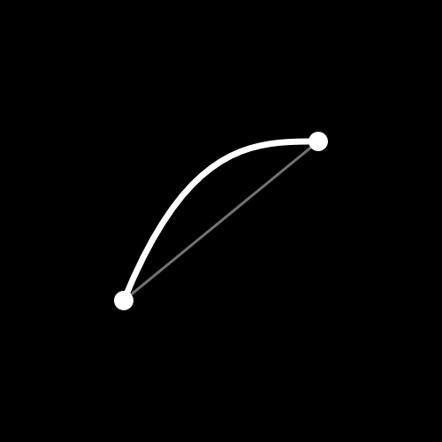

# kyfram

[](https://github.com/codetesla51/kyfram/actions/workflows/ci.yml)
[](https://go.dev)
[](https://github.com/codetesla51/kyfram/releases)
[](LICENSE)

<p align="center">
  
</p>
<p align="center"><sub>Logo made with kyfram</sub></p>

> Keyframe-driven rendering engine — declare what shapes look like at specific times, Go renders to `mp4`/`png` via `gg` + `ffmpeg`.

**Docs → [kyfram-site-68056d.gitlab.io](https://kyfram-site-68056d.gitlab.io/index.html)** — install, quickstart, and reference. This README is the quick pitch.

## What is kyfram?

`kyfram` is a small, opinionated engine for motion graphics. You write a `.lgv` script in [Logos](https://github.com/codetesla51/logos) declaring states-at-times — `scene()`, `shape()`, `text()`, `group()`, `camera()`, `audio()` — and Go owns the tweening: `Timeline → Interpolate(t) → gg canvas → ffmpeg`.

Think CSS `@keyframes` for video: retiming is editing a number, not re-directing callbacks.

## Why not After Effects, Remotion, or Manim?

After Effects is a full timeline editor, Remotion is React-first, and Manim is Python and math-first. kyfram is narrower: a Go library and CLI for deterministic motion graphics. Scenes are plain code, renders are reproducible, and the output fits naturally into scripts and CI. It is not a replacement for an editor, and it does not try to be one.

## Pronunciation

**kyfram** — *KAI-fram* /kaɪ.fræm/, like **keyframe** without the *e*.

## Features

- **Declarative keyframes** — times are quoted strings (`"0"`, `"1.5"`), engine lerps numbers/colors/arrays and snaps text.
- **Easing per segment** — `linear`, `easeIn/Out/InOut`, `cubicIn/Out/InOut`, `sine`, `spring`, `bounceIn/Out/InOut`.
- **One-line entrances** — `fadeIn()`, `slideIn()`, `popIn()` synthesize keyframe tables; pass a start time and duration when needed.
- **Per-letter text** — `letters()` measures glyph advances, staggers each letter, and supports newlines/wrapping.
- **Stroke draw-on** — `trim` / `trimStart` reveal a `line` or `path` by length.
- **Rich primitives** — `circle`, `rect`, `roundRect`, `polygon`, `star`, `ellipse`, `line`, `arc`, `wave`, `path`, `image`, `svg`, `text`.
- **SVG import** — `svg()` loads a static SVG document as one animatable entity; paths, groups, transforms, solid fills, and linear/radial gradients are preserved.
- **Groups** — `group()` with local `x/y`, keyframed `x y scale rotate alpha layer`, and optional `parent` for nesting.
- **Clipping** — crop groups and entities to `rect`, `roundRect`, `circle`, or `path` shapes.
- **Camera** — keyframed pan/zoom for the whole scene.
- **Style** — gradients (`gradFrom`/`gradTo`), blend modes, shadows, blur, glow, alpha/rotate/scale/layer per entity.
- **Audio + TTS** — `audio()` mux and `tts()` (Edge neural → `espeak-ng` → beeps) with word timings for synced text.
- **Preview + templates** — `kyfram view` hot-reload, `render --var k=v` and `text_file()` for batch renders.

See docs for the full scripting reference.

## Install

```sh
curl -fsSL https://raw.githubusercontent.com/codetesla51/kyfram/master/install.sh | sh
```

Specific version or update:

```sh
curl -fsSL https://raw.githubusercontent.com/codetesla51/kyfram/master/install.sh | sh -s -- v0.5.0
# or
VERSION=v0.5.0 sh install.sh
```

Prebuilt binaries for linux/darwin (amd64/arm64) are downloaded from the
[GitHub release assets](https://github.com/codetesla51/kyfram/releases);
installing from source needs Go 1.25+:

```sh
go install github.com/codetesla51/kyfram/cmd/kyfram@latest
```

## Quick start

```js
// examples/intro.lgv
scene(2, 30)

shape("ball", "circle", table{
    "0": table{x: 100, y: 180, r: 40, color: "#e64c40"},
    "2": table{x: 540, y: 180, r: 40, color: "#e64c40"},
})
```

```sh
go run ./cmd/kyfram render --out out.mp4 examples/intro.lgv
go run ./cmd/kyfram view examples/intro.lgv   # http://localhost:7070
```

Requires `ffmpeg` on `PATH` (mp4 encoding; png renders work without it).

Entrance helpers are built in:

```js
shape("ball", "circle", popIn(table{x: 100, y: 180, r: 40, color: "#e64c40"}))
```

`fadeIn()`, `slideIn()`, and `popIn()` return keyframe tables. Pass a start
time and duration as optional second and third arguments. `slideIn()` also
takes a direction (`left`, `right`, `up`, `down`) and distance.

## Motion graphics recipes

`examples/motion-kit.lgv` combines all five recipes below in one 4-second
scene.

### Per-letter text

`letters(name, content, keyframes, stagger, group)` expands content into one
`text` entity per non-space glyph. It measures advances with the first
keyframe's `font` and `size`, centers each line on `x`, and delays each glyph
by `stagger` seconds. Explicit `\n` breaks start new lines; a `wrap` value
also wraps each line at that pixel width. Keep `font` and `size` constant
across the animation so the spacing stays stable.

```js
letters("title", "MOTION", table{
    "0": table{x: 640, y: 250, size: 96, color: "#f6f1e7", alpha: 0, scale: 0.9, ease: "spring"},
    "0.42": table{x: 640, y: 250, size: 96, color: "#f6f1e7", alpha: 1, scale: 1},
}, 0.08)
```

The optional fifth argument puts every generated glyph in a group. Spaces
advance the line but do not create an entity. Generated names are
`title-0`, `title-1`, and so on.

### Stroke draw-on

`trim` is the visible fraction of a `line` or `path` from its start;
`trimStart` moves the beginning of that window. Animate `trim` from `0` to
`1` to draw a stroke on. Paths use arc length across all subpaths. Filled
paths ignore trimming.

```js
shape("rule", "line", table{
    "0": table{x1: 300, y1: 330, x2: 980, y2: 330, width: 3, color: "#f4b942", trim: 0},
    "0.8": table{x1: 300, y1: 330, x2: 980, y2: 330, width: 3, color: "#f4b942", trim: 1},
})
```

### Nested groups

A group can name another group with `parent`. The child's local transform is
applied inside the parent, so moving or rotating the parent carries the whole
subtree. Root groups default to the canvas center; nested groups default to
their parent's origin. Each parent orders its entities and child groups by
`layer`.

```js
group("rig", table{"0": table{x: 1010, y: 490, rotate: 12}})
group("arm", table{"0": table{x: 0, y: 0, rotate: 24, parent: "rig"}})
shape("chip", "rect", table{
    "0": table{x: -46, y: -46, w: 92, h: 92, color: "#5fd0c4"}
}, "arm")
```

Parents can be declared before or after children. Build rejects missing
parents and cycles.

### Clipping

`clip` crops a group or entity to a shape. Clipping happens in local
coordinates, so it moves with the group and composes through nested groups.
Available shapes are `rect`, `roundRect`, `circle`, and `path`. Use `none`
to turn a clip off again.

```js
group("window", table{
    "0": table{x: 320, y: 180, clip: "rect", clipW: 0, clipH: 220},
    "1": table{x: 320, y: 180, clip: "rect", clipW: 480, clipH: 220},
})
shape("photo", "image", table{
    "0": table{path: "examples/assets/photo.jpg", x: 0, y: 0},
}, "window")
```

`clipX`/`clipY` center the rectangle or circle (default `0,0` in local
space). A path clip uses `clipD` (SVG path data) or `clipPoints` and is
translated by `clipX`/`clipY`. For example, `clip: "circle", clipR: 120`
reveals only a circular region around the group origin.

### Shadows, blur, and glow

Effects are per entity: shadows and glows are silhouettes of the entity's
own alpha, so transparent text and images keep their edges.

```js
shape("title", "text", table{
    "0": table{
        content: "GLOW", x: 320, y: 180, size: 72, color: "#ffffff",
        shadowColor: "#000000", shadowBlur: 12, shadowX: 0, shadowY: 8,
        glow: "#f4b942", glowBlur: 18,
    },
})
```

- `shadowColor` turns on a shadow; `shadowBlur` defaults to `10`, and
  `shadowX`/`shadowY` offset it.
- `glow` turns on a colored halo; `glowBlur` defaults to `16`.
- `blur` blurs the entity itself.

Effects render through an offscreen layer, so they are more expensive than
plain shapes. They can be combined with blend modes and clipping.

### Multiline text

`text` breaks on explicit `\n` and, when `wrap` is nonzero, wraps words to
that pixel width. The block stays centered on `x/y`. `lineHeight` is a
multiplier on the measured font height (default `1.2`).

```js
text("body", table{
    "0": table{
        content: "A title line\nand a wrapped second paragraph",
        x: 640, y: 360, size: 32, color: "#f6f1e7",
        wrap: 520, lineHeight: 1.35,
    },
})
```

### SVG import

`svg(name, path, keyframes, group)` loads a static SVG file as one entity.
`x/y` is the center of the target box and `w/h` is its size; the document's
`viewBox` and `preserveAspectRatio` handle fitting. Rotation, scale, alpha,
clipping, and the effect props work exactly like any other entity.

```js
svg("mark", "examples/assets/kyfram-mark.svg", table{
    "0": table{x: 640, y: 320, w: 360, h: 360, scale: 0.7, alpha: 0},
    "0.9": table{x: 640, y: 320, w: 360, h: 360, scale: 1, alpha: 1,
        ease: "easeOut"},
})
```

You can also use `shape(name, "svg", keyframes)` with a `path` prop. The
importer understands `path`, `rect`, `circle`, `ellipse`, `line`,
`polyline`, and `polygon`; nested groups and `<use>` references; `translate`/
`scale`/`rotate`/`skewX`/`skewY`/`matrix` transforms; presentation attributes
and inline `style`; solid colors; and linear/radial gradients. SVG path data
supports `M/L/H/V/C/S/Q/T/A/Z`, absolute and relative.

Text, CSS selectors, clip paths, masks, filters, patterns, and external
images are ignored. Convert those to paths or draw them with kyfram
primitives when possible.

### Rotation pivot

`rotate` pivots around the shape's natural center:

- `rect` and `roundRect`: center of the rectangle, at `(x + w/2, y + h/2)`.
  `x` and `y` remain the top-left corner.
- `circle`, `star`, `ellipse`, and each `text` glyph: the `x/y` point.
- `line`: midpoint of the two endpoints.
- groups: the group's local origin.

### Easing

`spring` overshoots and settles; `bounce`, `bounceOut` land with four
decreasing bounces; `bounceIn` and `bounceInOut` use the same curve at the
other end or both ends. All curves start at `0` and finish exactly at `1`.
