# kyfram

[](https://github.com/codetesla51/kyfram/actions/workflows/ci.yml)
[](https://go.mod)
[](https://github.com/codetesla51/kyfram/releases)

<p align="center">
  
</p>
<p align="center"><sub>Logo made with kyfram</sub></p>

> Keyframe-driven rendering engine — declare what shapes look like at specific times, Go renders to `mp4`/`png` via `gg` + `ffmpeg`.

**Docs → [kyfram.dev](https://kyfram.dev)** — full reference, examples, and API live there. This README is just the quick start.

## Quick start

```js
// examples/intro.lgv
scene(2, 30)

shape("ball", "circle", table{
    "0": table{x: 100, y: 180, r: 40, color: "#e64c40"},
    "2": table{x: 540, y: 180, r: 40, color: "#e64c40"},
})
```

```sh
go run ./cmd/kyfram render examples/intro.lgv --out out.mp4
go run ./cmd/kyfram view examples/intro.lgv   # http://localhost:8080
```

Requires Go 1.27+ and `ffmpeg` on `PATH`. See docs for install, CLI flags, and scripting.
